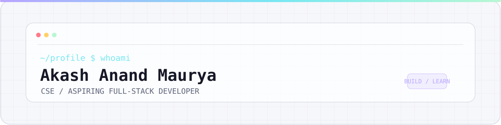
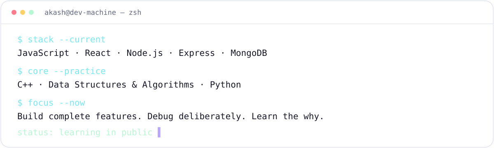

<!--
PROFILE README STARTER — PERSONALIZE BEFORE PUBLISHING
GitHub profile username assumed from your earlier repo URLs: akash-aanand.
IMPORTANT: The special repository name must match your actual GitHub username exactly.
Search for EDIT ME, TODO, and placeholder URLs before committing.
-->

<picture>
  <source media="(prefers-color-scheme: dark)" srcset="./assets/header-dark.svg">
  <source media="(prefers-color-scheme: light)" srcset="./assets/header-light.svg">
  
</picture>

  <strong>Building useful things for the web — one concept, one project, one commit at a time.</strong>

<!-- EDIT ME: If you'd prefer a different title, keep this sentence concrete and truthful. -->
I'm **Akash Anand Maurya**, a Computer Science & Engineering learner focused on becoming a **full-stack developer**. I enjoy understanding how the pieces fit together—from a React interface to an API and its database—not just making code run.

<picture>
  <source media="(prefers-color-scheme: dark)" srcset="./assets/terminal-dark.svg">
  <source media="(prefers-color-scheme: light)" srcset="./assets/terminal-light.svg">
  
</picture>

## `01` — Current focus

- **Building:** React interfaces and full-stack JavaScript projects.
- **Learning:** Node.js, Express, REST APIs, MongoDB/Mongoose, and better project structure.
- **Practising:** C++ and data structures & algorithms, with an emphasis on understanding the reasoning behind each solution.
- **Looking for:** Entry-level software development opportunities and projects where I can keep learning by shipping.

## `02` — Toolkit

**Frontend:** JavaScript · React · HTML · CSS · Tailwind CSS  
**Backend:** Node.js · Express.js · REST APIs · MongoDB · Mongoose  
**Core & tools:** C++ · DSA · Python · Git · GitHub

<!-- EDIT ME: Remove technologies you cannot yet discuss comfortably in an interview. Add TypeScript only when you're using it with confidence. -->

## `03` — Selected work

<!-- EDIT ME: These project names/URLs are based on projects mentioned in our earlier chats. Open every link before publishing; rename or replace any repo that is private, moved, or has a different URL. -->

- **[SuperAI Polaris](https://github.com/akash-aanand/super-ai-polaris)** — Product UI exploration combining TypeScript, interface design, and 3D motion.
- **[React revision series](https://github.com/akash-aanand/chai-auR-react)** — Small hands-on examples for React fundamentals, state, effects, and Context API.
- **[Backend Jokes](https://github.com/akash-aanand/backendjokes)** — Backend practice project for getting comfortable with server-side JavaScript and APIs.

<!-- TODO: Replace any link that doesn't open with the exact public repository URL. Pin your strongest 3–6 repositories on your GitHub profile too. -->

## `04` — How I work

- I prefer understanding **why** a pattern works, not only memorising syntax.
- I learn by building, debugging, revisiting fundamentals, and documenting useful lessons.
- I'm working toward writing code that is readable, maintainable, and useful to real people.

## `05` — Connect

- **GitHub:** [@akash-aanand](https://github.com/akash-aanand)
- **LinkedIn:** [Akash Anand Maurya](https://www.linkedin.com/in/akash-anand-maurya-1b2528239/)
- **X (Twitter):** [@AkashAnand83151](https://x.com/AkashAnand83151)
- **Email:** [akashanandmaurya@gmail.com](mailto:akashanandmaurya@gmail.com)
- **Portfolio:** Coming soon 🚀
<!--
OPTIONAL CONTRIBUTION SNAKE
1. Add .github/workflows/snake.yml from this kit and push it to main.
2. Run it from the Actions tab once and wait for a successful run.
3. Confirm these files exist on the output branch:
   - github-snake.svg
   - github-snake-dark.svg
4. Then uncomment the block below.

<picture>
  <source media="(prefers-color-scheme: dark)" srcset="https://raw.githubusercontent.com/akash-aanand/akash-aanand/output/github-snake-dark.svg">
  <source media="(prefers-color-scheme: light)" srcset="https://raw.githubusercontent.com/akash-aanand/akash-aanand/output/github-snake.svg">
  
</picture>
-->

<!--
FINAL PRE-PUBLISH CHECK:
- Confirm your actual GitHub username and repository names.
- Replace LinkedIn, email, and portfolio placeholders.
- Remove all EDIT ME / TODO / [Check repo URL] comments.
- Keep the optional snake block commented until the workflow succeeds.
-->
